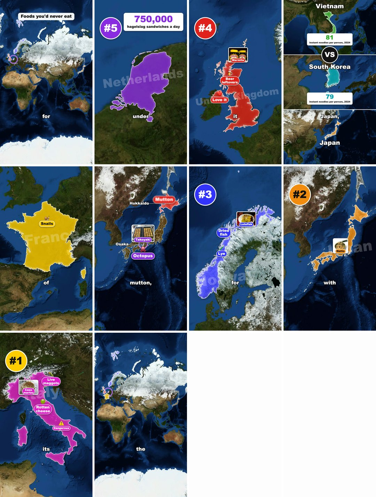

# mapreel: narrated world-map fact reels

`mapreel` makes a vertical 1080x1920 reel on a world map. The camera flies to a country,
the country fills with colour, and a logo, a dish or a number pops in at the moment the
voice says it. Think "brands you didn't know were from these countries" or "what each US
state eats".

The script is written by an agent, not by the recipe. The recipe checks it, renders it
and refuses a script that would lose viewers in the first two seconds.



*`storyboard.jpg` for `examples/mapreel/food.json`: one still per segment, satellite look.*

## Run it

```bash
REEL_TTS=fake REEL_HYPERFRAMES_WORKERS=1 uv run reel run mapreel -i @examples/mapreel/food.json
```

`mode` is `storyboard` in that file, so it renders the stills and `sources.md` only. It
takes under a minute and costs nothing. To get the video, set `"mode": "build"`. A free
local voice reads it aloud:

```bash
REEL_TTS=macos REEL_HYPERFRAMES_WORKERS=1 uv run reel run mapreel \
  -i @examples/mapreel/food.json -i '{"mode": "build", "voice": "macos:Samantha"}'
```

Later `-i` values win. `reel run` prints the path of every file the job made, `reel.mp4` among them; over MCP, `get_artifact` fetches one.

What you need: ffmpeg and ffprobe, and for a build Node 22 or newer (HyperFrames runs
through `npx`) and Chrome. `REEL_HYPERFRAMES_WORKERS=1` streams frames straight into the
encoder: slower, but light on memory. The first run downloads the map data (see
[Data and licences](#data-and-licences)).

Two example scripts ship with the repo: `examples/mapreel/food.json` (a ranked countdown,
a versus, a regions segment, five Wikimedia Commons photos) and `examples/mapreel/brands.json`
(five countries and their brands). [examples/mapreel/README.md](../examples/mapreel/README.md)
has the commands for the fake, macOS and Cartesia voices.

## The agent workflow

Every step is an MCP tool ([MCP.md](MCP.md)). None of them waits for a render.

1. `describe_recipe("mapreel")`. Returns the input schema, an example and the `guide`:
   the workflow, hook formulas, re-hooks, endings, topic ideas and the lint rules. Read
   the guide before writing. It is the source of truth for how to write a script; this
   page only shows the shape of the model. The guide lives in
   `reelmachine/recipes/mapreel/guide.py`.
2. `find_places`. Turn names into codes: `{"query": "holland"}` gives `NLD`. For a
   `regions` segment, list a country's states: `{"query": "", "country": "USA"}`.
3. `find_images`. Search Wikimedia Commons: `{"query": "Nike", "kind": "logo"}`. Put a
   result's `id` in an item's `image`.
4. `probe`. Checks the script, the places, the lint and the voice, and returns the cost.
   Fix every failed check and every finding in `details.lint`.
5. `start_job` with `"mode": "storyboard"`. Look at `storyboard.jpg` with `get_artifact`.
6. `start_job` with `"mode": "build"`. Paste `sources.md` into the video description.

`probe` returns `details.estimatedMs` (the reel's length), `details.segments` (the codes
each segment resolved to) and `details.cost.ttsCharacters` (what the voice will bill).

## The script model

The input is one JSON object:

| field | default | meaning |
|---|---|---|
| `segments` | required | 1-40 segments, in order (see below) |
| `mode` | `build` | `storyboard` renders one still per segment; `build` renders the reel |
| `title` | `""` | up to 80 characters, shown on the first shot |
| `look` | `satellite` | `satellite`, `flat` or `dark` (see [Looks](#looks)) |
| `voice` | `fake:default` | `<provider>:<voice>` (see [Voices](#voices)) |
| `language` | `en` | the narration language |
| `length` | none | target seconds, 15-90. Pads or tightens the pacing |
| `music` | none | `"auto"` for a synthesised bed, or a local audio file |
| `lint` | `strict` | `strict` or `warn` (see [The hook lint](#the-hook-lint)) |
| `name`, `outdir` | none | file name and folder for the output |

Every segment has a `kind`, a `narration` (1-400 characters, the line the voice reads),
and optionally `camera`, `source` and `colour`. Segments have no ids: they are `seg-1`,
`seg-2` and so on, in order.

### The five kinds

`country`: one country, 1-8 items.

```json
{"kind": "country", "country": "FRA", "narration": "France eats snails and frog legs.",
 "items": [{"name": "Snails", "emoji": "🐌"}, {"name": "Frog legs", "emoji": "🐸"}]}
```

`highlight`: 1-60 countries fill at once, with an optional `legend`. Good for the hook
and the closing shot.

```json
{"kind": "highlight", "countries": ["FRA", "JPN", "ITA"], "legend": "Foods you'd never eat",
 "narration": "Three foods you'd never eat. Number one is banned for sale."}
```

`rank`: a countdown beat with a numbered badge (`rank` 1-99), an optional `stat` that
counts up on screen, and up to 8 items. Rank 1 pays off a "number one" tease.

```json
{"kind": "rank", "rank": 5, "country": "NLD",
 "stat": {"value": "750,000", "label": "hagelslag sandwiches a day"},
 "narration": "Number five: the Netherlands eats 750,000 sandwiches a day under chocolate sprinkles.",
 "items": [{"name": "Hagelslag", "say": "chocolate sprinkles", "emoji": "🍫"}]}
```

`versus`: two or three different countries side by side, one panel and one `stats` entry
each. Say each value and country in the narration.

```json
{"kind": "versus", "countries": ["VNM", "KOR"],
 "stats": [{"value": "81", "label": "instant noodles per person"},
           {"value": "79", "label": "instant noodles per person"}],
 "narration": "Who eats the most instant noodles? Vietnam, 81. South Korea, 79."}
```

`regions`: a country's states or prefectures fill one by one as the voice names them
(1-12 regions, each with up to 6 items). Name a region by its ISO 3166-2 code (`US-TX`,
`JP-13`) or by name. Get the codes from `find_places` with `country=`.

```json
{"kind": "regions", "country": "JPN",
 "narration": "Osaka eats takoyaki. Hokkaido grills mutton.",
 "regions": [{"region": "JP-27", "say": "Osaka", "items": [{"name": "Takoyaki", "emoji": "🧆"}]},
             {"region": "JP-01", "say": "Hokkaido", "items": [{"name": "Mutton", "emoji": "🐑"}]}]}
```

### Items, `say`, `at`, `image`, `source`

An item is one thing shown on a place. It pops when the voice says it.

- `name`: what the badge shows (up to 60 characters).
- `say`: how the voice says it, when that differs from `name`. The recipe matches `say`
  in the narration instead of `name`. In the example above the badge reads "Hagelslag"
  and pops on "chocolate sprinkles". Keep `say` short.
- `at`: a time in seconds from the start of the segment. It overrides the speech match.
  Use it only when the name never appears in the narration.
- `image`: `commons:File:<name>` (the `id` from `find_images`), an `https://` URL, or a
  local file path. The image shows as a white-framed photo card with the name on a pill
  along its bottom edge. With no usable image, the item shows as a bold text badge in the
  country's colour. `emoji` is the light alternative.
- `source`: the URL of the page that states the fact. `source` can also sit on the
  segment, on a `stat`, or on a rank.

A stat's first number counts up on screen (`"750,000"`, `"$5.69"`). Say the value in
the narration so it lands with the voice.

### `camera` and `colour`

```json
{"camera": {"zoom": 1.5, "hold": true}, "colour": "#e63946"}
```

- `camera.zoom`: 0.5 to 3.0, default 1.0. Above 1 zooms in.
- `camera.hold`: `true` keeps the camera where it is instead of flying to this segment.
  Use it to stay on a map across two segments.
- `colour`: `#rrggbb` for the segment's fill. Without it the recipe picks colours from a
  palette. A `regions` entry takes its own `colour` too.

An unknown field is refused, so a typo fails at `probe` rather than being ignored.

## The hook lint

A map reel lives or dies in its first two seconds. The recipe checks the script against
eight rules before it renders. `probe` returns the findings in `details.lint`: each has a
`rule`, a `severity`, a `message` and a `hint` that says what to change.

| rule | what it flags | severity |
|---|---|---|
| `weak-opener` | the first seven words have no hook (a number, a question, "you", a superlative, "only"), or open "Welcome", "Today", or a plain "X has..." | error in a strict build |
| `unpaid-loop` | the opening teases ("number one", "guess", "at the end") and nothing pays it off | error in a strict build |
| `beat-gap` | more than 1.2 s of narration with nothing new on screen | warning |
| `no-rehook` | more than 12 s with no rank, versus or highlight segment and no re-hook line | warning |
| `monotony` | four or more `country` segments in a row | warning |
| `length` | the script reads well short of `length`, or runs past 75 s | warning |
| `unsourced` | an item, stat or rank with no `source` | warning |
| `no-ending` | the last line asks nothing and is not a rank 1 payoff | warning |

With `"lint": "strict"` (the default) a build refuses a script with a `weak-opener` or
`unpaid-loop` error. A storyboard only warns. Here is what a refusal looks like:

```text
the opening line has no hook: 'Japan has many foods.'
open on a surprise, a number, a challenge or 'you' in the first seven words, never 'X has...'
```

Fix the opening, not the setting. Opening lines that pass: "Five foods you'd never eat",
"Only one country eats this for breakfast", "You think Nike is American. It's not." If
you really want the script as written, set `"lint": "warn"` and both rules become
warnings. `beat-gap` is a suggestion: a few are fine, and a natural sentence beats a
filler card.

## Looks

`look` applies to every segment.

- `satellite` (default): NASA Blue Marble imagery, vivid fills with a white glow. The most
  cinematic.
- `flat`: a clean atlas with pale sea, cream land and grey borders. Reads best for dense
  or data-heavy reels.
- `dark`: a night map, navy land on near-black sea, fills glow neon. Good for dramatic
  topics.

`flat` and `dark` are drawn from Natural Earth and need no satellite download.

## Voices

`REEL_TTS` picks the narration provider for the whole deployment: `fake`, `macos`,
`cartesia`, `elevenlabs` or `supertonic`. The script's `voice` names a voice on that provider, as
`<provider>:<voice>`.

| `REEL_TTS` | `voice` example | cost | key |
|---|---|---|---|
| `fake` | `fake:default` | free | none. One tone burst per word, with exact word timings; use it for storyboards and tests |
| `macos` | `macos:Samantha` | free | none. Uses the Mac's own voices; macOS only. The best free way to hear a real build |
| `cartesia` | `cartesia:<voice-id>` | per character | `CARTESIA_API_KEY` |
| `elevenlabs` | `elevenlabs:<voice-id>` | per character | `ELEVENLABS_API_KEY` |
| `supertonic` | `supertonic:F1`, `supertonic:<cloned-voice-id>` | free, your own GPU or CPU | `REEL_SUPERTONIC_URL` (default `http://127.0.0.1:8787`); `SUPERTONIC_API_KEY` if the server has one. Word timings are estimated, not aligned |

Use macOS for local tests and Cartesia, ElevenLabs or a Supertonic server for production. The voice in the
script must match `REEL_TTS`, or the job fails with `VOICE_UNAVAILABLE`.

`probe` reports the cost before you spend it: `details.cost` is
`{"ttsCharacters": 814, "voice": "fake:default"}`, the number of characters the voice will
read. Only the cloud providers bill for them. The `voice` check in `probe` fails when the
script's provider is not the one the deployment serves.

## Artifacts

| artifact | in | what it is |
|---|---|---|
| `storyboard.jpg` | both modes | a contact sheet with one still per segment |
| `script.resolved.json` | both modes | the script with every place resolved to a code, plus the lint findings |
| `sources.md` | both modes | every claim's source, every image's licence, the map and voice credits |
| `reel.mp4` | build | the 1080x1920 video |
| `captions.srt` | build | the narration as captions |
| `reel.json`, `timeline.json` | build | the timeline the video was rendered from |

Paste `sources.md` into the video description. It lists each `source` URL, each image's
licence, author and link, and the credits for the map and the voice. An image given as an
https URL or a local file is marked caller-supplied: you answer for its rights.

After a build, `verify` inspects the file itself: format (1080x1920 with video and
audio), duration against the narration, the narration's volume, no still stretch longer
than 2.4 s, every item visibly popping, and the segments and manifest naming the same
renderer. The report is saved in the job's manifest with each check's result; a failed
check names what is wrong but does not fail the job, so read it before you publish. A map
layer that fails to load in the renderer does fail the job, with the layer named.

## Data and licences

- **Natural Earth** (public domain) supplies the borders, and the states and prefectures.
  It is fetched once into the cache on first use. The admin-1 file for `regions` is about
  40 MB and is fetched only when a script uses a `regions` segment.
- **NASA Blue Marble** (public domain) is the satellite imagery for `look: satellite`.
- **Wikimedia Commons** supplies item images. `find_images` returns only free licences
  (public domain, CC0, CC BY, CC BY-SA and the like) unless you pass `include_nonfree`. A
  result with `permitted: false` is never drawn. A free file can still carry a trademark:
  read `restrictions` and leave a logo out when unsure. Each shown image is credited in
  `sources.md` with its licence, author and link.

## Troubleshooting

**A weak-hook refusal.** `the opening line has no hook` or an unpaid tease is the strict
lint doing its job. Rewrite the opening with a formula from the guide's `hooks`, or end on
a rank 1 segment that pays off "number one". `"lint": "warn"` lets it through.

**An unknown place.** `no country called 'Narnia'` comes with a hint:
`did you mean Mauritania, Romania, Nigeria, Namibia, Armenia?`. The error path (for
example `segments[0].countries[0]`) says which entry. Resolve the name with `find_places`
and use its code. For an ambiguous name such as `Korea`, the results say so: pick `KOR`
or `PRK`.

**A missing Node or HyperFrames.** `probe` fails the `renderer` check and says what is
missing (Node 22 or newer, HyperFrames, Chrome, ffprobe). A storyboard needs the renderer
too. Run `uv run reel doctor` and install what it lists. The first render fetches the
pinned HyperFrames through `npx`, so it needs the network once.

**The voice does not match the deployment.** `the voice 'fake:default' needs the 'fake'
narration provider, but this deployment serves 'cartesia'`. Either put
`REEL_TTS=fake` in front of the command (or in `.env`), or change the script's `voice` to
`cartesia:<voice-id>`.

**Out-of-credit TTS.** When the vendor answers 401, 402 or 403 (a bad key, no credit, a
voice the plan lacks), the job fails with `VOICE_UNAVAILABLE` and a hint: `check the
Cartesia API key`, `top up the Cartesia account, or use another voice provider`, or `this
Cartesia plan cannot use that voice`. The keys are `CARTESIA_API_KEY` and
`ELEVENLABS_API_KEY`. Top up and run the job again, or switch to `REEL_TTS=macos` and
`macos:Samantha` to keep working for free.

**An image shows as a text badge.** The id was wrong, its licence was not free, or the
download failed. `find_images` again, check `permitted`, or use an `emoji`. What happened
is in `verification.visible_degradation` (the first five) and in `warnings` in
`script.resolved.json` (all of them), in storyboard and build mode alike.
